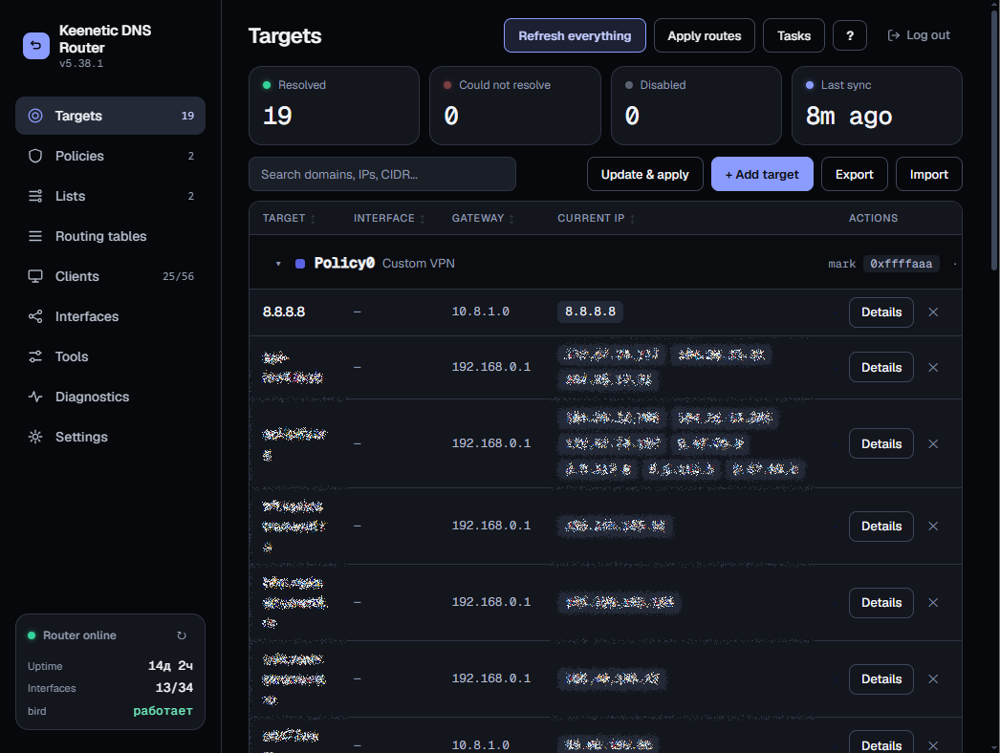
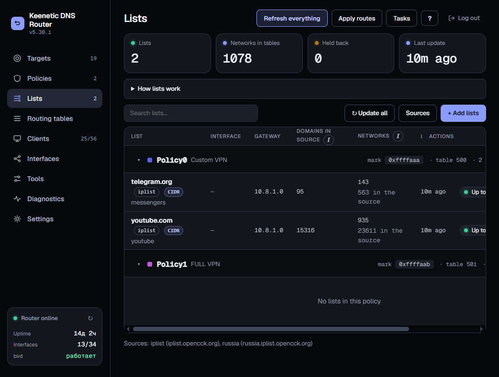
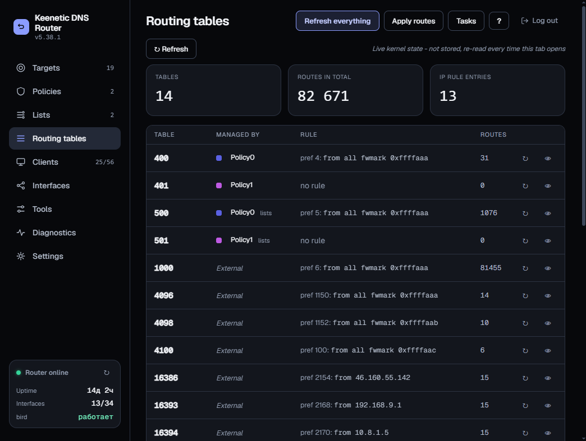
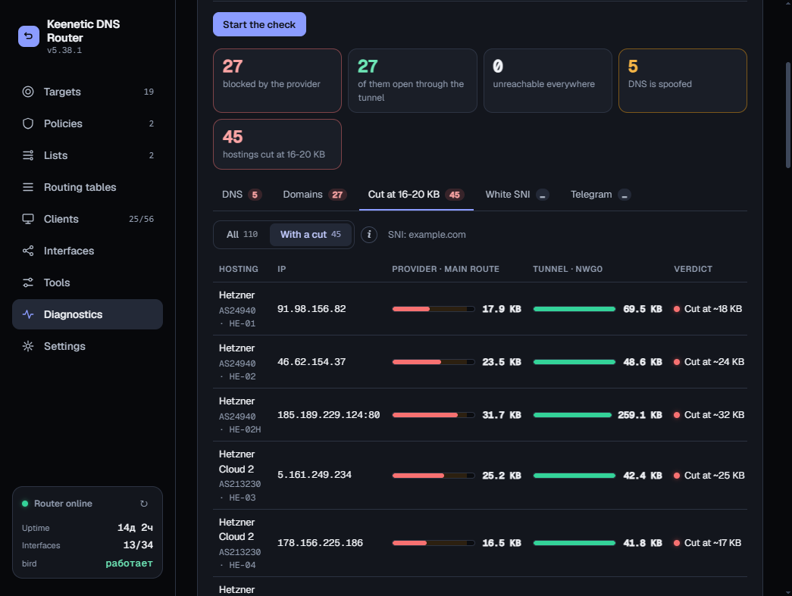

# Keenetic DNS Router

A self-hosted panel for a Keenetic router that routes chosen domains, IP lists and whole
services through the policy you pick — a VPN tunnel, a second provider, or a BGP feed.

The panel keeps its targets in SQLite, resolves them through the DNS servers you choose,
downloads IP lists from a source such as [iplist.opencck.org](https://iplist.opencck.org),
and writes the routes into the policy tables of the router with `ip rule` / `ip route`.
It runs on the router itself under Entware: PHP + nginx, no cloud, no build step.

**Version 5.48.1** · [Changelog](CHANGELOG.md) · [Русская версия](README.ru.md) · [Изменения по-русски](CHANGELOG.ru.md)

---

## What it does

| Tab | Purpose |
|---|---|
| **Targets** | Domains, IPs and networks, each with its policy and exit (interface and gateway). Resolved on a schedule, grouped by policy, bulk editing, backup exit. |
| **Policies** | Keenetic policies with their fwmark and routing table, live traffic and route counts. |
| **Lists** | IP/domain lists from a source, a catalog of services, and your own lists from pasted text or a link. Subnets are aggregated, a list that lost half its entries is held back. |
| **Clients** | Devices from the router, their policy, live connections, registration. |
| **Interfaces** | Router interfaces, addresses, statistics, WireGuard peers, Keenetic connectivity checks (ping-check). |
| **Routing tables** | Live kernel tables and rules, the router's own static routes, and the routing order. |
| **Diagnostics** | DPI check after [dpi-detector](https://github.com/Runnin4ik/dpi-detector): spoofed DNS, TLS reset by SNI, the 16–20 KB cut, QUIC, white SNI, Telegram data centres. |
| **Tools** | Test route (a real `curl` through the interface of a route), bird4/BGP with a config wizard, ndm hooks, system checks. |
| **Settings** | DNS for lookups, downloads through an interface, task pause, panel update from GitHub. |

Routes are applied without a gap: new routes are written over the old ones and only then
are the stale ones removed, so traffic keeps its route the whole time. When nothing
changed, nothing is written and no root call is made.

Long work (resolving, downloading, applying) runs as a background task on the router with
a queue and a log — the page can be closed. ndm hooks re-apply the routes when the
firewall is rebuilt or an interface changes.

## Screenshots





## Requirements

* Keenetic with the **OPKG packages** component enabled, and Entware installed on a drive.
* nginx + `php-fpm` and `php-cli`, **PHP 8.1 or newer** (`array_is_list()` is used), with `php-mod-sqlite3`.
* `ip-full` (the busybox `ip` cannot do `route get ... mark`), `curl`, `ca-bundle`.
* Optional: `php-mod-openssl` and `php-mod-sockets` for the DoT and QUIC columns of the DPI
  check, `bird1-ipv4` for BGP.
* The admin password of the Keenetic web UI — it is used for `su` to run `ip rule`/`ip route`.

The panel checks all of this itself: **Tools → System checks**, or `app.php checks` from
the shell. Every failed check comes with the command that fixes it.

## Install

### install.sh — the usual way

Download `install.sh` and `dns-router.tar.gz` from the release into one directory on the
router and run it as root:

```sh
sh install.sh
```

Without the archive next to it, `install.sh` downloads the latest release itself. It asks
for the Keenetic admin password and a panel password (Enter generates one), offers bird/BGP
and the panel port (**880** by default), installs the Entware packages, fixes `php.ini` and
php-fpm, writes `nginx.conf`, unpacks the panel, then calls `app.php install` and checks that
the panel answers.

| Variable | Meaning | Default |
|---|---|---|
| `MANUAL=1` | Do not touch nginx, `php.ini`, php-fpm or packages — only the panel files | off |
| `WWW=/path` | Panel directory | `/opt/share/www/dns-router` |
| `PORT=NNN` | Panel port | `880` |
| `RCI=http://127.0.0.1:NN` | Local Keenetic RCI address | `http://127.0.0.1:79` |
| `WITH_BIRD=1` | Install bird without asking | off |
| `RELEASE_URL=…` | Where to download the archive from | the latest GitHub release |
| `WEBUSER_ENV=name` | php-fpm user in `MANUAL=1` mode | taken from the config owner |

An existing installation is recognised by `config.php`: the router password is not asked
again, the files are replaced and whatever is missing is repaired. **Panel 4.x is upgraded
in place** — its directory is found by `api.php`, and `lib.php`, `api.php`, `css/`, `js/` and
the other old scripts are removed afterwards. Before any of that, the old panel, config and
database are packed into `/opt/var/dns-router-backup/before-install-<date>/`, and the path is
printed at the end so you can roll back.

At the end it prints the panel address, the login, the generated password if there was one,
and the output of `app.php checks`. Leftover cron jobs and foreign ndm hooks of the old panel
are reported, not deleted.

### app.php install — by hand

Put the panel files in a directory served by nginx (for example `/opt/www/dns-router`),
then as root:

```sh
DNSR_ROUTER_PASS='keentic-admin-password' \
DNSR_PANEL_PASS='panel-password' \
DNSR_WEB_USER=nobody \
/opt/bin/php-cli /opt/www/dns-router/app.php install
```

| Variable | Meaning | Default |
|---|---|---|
| `DNSR_ROUTER_PASS` | Keenetic admin password, used for `su` | required |
| `DNSR_PANEL_PASS` | Password for the panel itself (4+ characters) | required |
| `DNSR_PANEL_USER` | Panel login | `admin` |
| `DNSR_WEB_USER` | User that nginx/php-fpm runs as | `nobody` |
| `DNSR_CONF_DIR` | Where `config.php` and the database live | `/opt/etc/dns-router` |
| `DNSR_RCI` | Local Keenetic RCI address | `http://127.0.0.1:79` |

`app.php install` writes `config.php`, creates the database, installs the ndm hooks and
fixes the ownership so the web user can write. It keeps an existing config and database, and
it never touches nginx, `php.ini` or packages — that part is `install.sh`'s job.

Alternatively open the panel in a browser and follow the two-step setup wizard: it shows
the system checks, asks for the router access and the panel login, then creates the database.

`config.php` is looked up in this order: `$DNSR_CONFIG`, `/opt/etc/dns-router/config.php`,
`config.php` next to `app.php`. See [config.example.php](config.example.php).

### nginx

Serve the panel directory over HTTPS if it is reachable from outside the LAN. `app.php`
sends `X-Content-Type-Options: nosniff` and `X-Frame-Options: DENY` itself, and the page
carries a Content-Security-Policy that forbids foreign scripts.

`install.sh` writes its own `nginx.conf` (the old one is kept as `nginx.conf.orig`) and
refuses to continue if nginx does not accept it. With `MANUAL=1` it leaves your configuration
alone and prints the lines to add instead. `app.php install` never touches nginx at all.

Either way, make sure `config.php` (it holds the router password), the database and `ext.php`
are not served — keep the config and the database outside the web directory (the default
`/opt/etc/dns-router` already is), or deny them explicitly:

```nginx
location ~ ^/(config\.php|routes\.db|ext\.php|dpi/.*)$ { return 404; }
client_max_body_size 8m;   # uploading an update from Settings
```

`client_max_body_size` is the outer ceiling of an uploaded update: the panel's own limit is
**Settings → Timeouts and limits → Panel and security → Largest update archive** (5 MB by
default). Raising the panel limit above 8 MB only helps if nginx is raised too.

## Command line

```
app.php <apply|update|event|sync|listsync|job|fetch|passwd|hooks|checks|install>
```

| Command | What it does |
|---|---|
| `apply` | Write the routes from what is stored — no DNS lookups, no downloads. |
| `update` / `event` | Queue a task (this is what the ndm hooks call). |
| `sync` | Re-read the policies from Keenetic. |
| `fetch <url>` | Check the download path with the panel's own settings: folder, curl, interface, seconds, bytes and the reason it failed. |
| `checks` | System checks with the commands that fix them. |
| `hooks` | Reinstall the ndm hooks. |
| `passwd <new>` | Change the panel password. |
| `install` | Install or repair the panel (see above). |

## Updates

**Settings → Panel update** shows the newest release and what changed, downloads
`dns-router.tar.gz` from GitHub, verifies it against the sha256 that GitHub publishes,
checks the PHP syntax of every file, and installs it with a rollback. An older or the same
version is refused. A `.tar.gz` can also be uploaded by hand.

Only these files are ever taken from an archive: `app.php`, `ext.php`, `index.html`,
`app.js`, `style.css` and `lang.<code>.json`. Anything else — including directory entries —
makes the panel reject the whole archive.

The archive is unpacked to a file in 64 KB chunks and every file is written straight into the
staging folder, so checking a release costs almost no memory: a router with `memory_limit = 8M`
in php.ini passes it, even when that limit cannot be raised at runtime. The request also takes
its own limit from **Settings → Web request memory**, the unpacked size is capped by
**Largest unpacked update**, and the language file is validated by a child `php-cli` so the
dictionary is never parsed inside the web request.

### Making a release

Tag the commit `vX.Y.Z` and push the tag. The version lives in four places and they must
agree: `APP_VERSION` in `app.php`, `JS_VERSION` in `app.js`, the `Version X` line under the
title of this file and the `Версия X` line of [README.ru.md](README.ru.md).
`index.html` carries no number: the badge in the sidebar is filled by `app.js` from
`JS_VERSION`, so a cached page can never show a version that is not running. The workflow in
[.github/workflows/release.yml](.github/workflows/release.yml) checks the syntax of every
file including `install.sh`, builds `dns-router.tar.gz` with exactly the allowed files and
publishes the release with the notes taken from `CHANGELOG.md` and `CHANGELOG.ru.md`.

The release carries two assets: `dns-router.tar.gz` (what the panel installs) and
`install.sh` (what you run on the router). `install.sh` is deliberately **not** inside the
archive — the panel refuses any file it does not know.

To build the same archive by hand:

```sh
tar --no-recursion --format=gnu -czf dns-router.tar.gz \
    app.php ext.php index.html app.js style.css lang.ru.json
```

`--no-recursion` with an explicit file list matters: a directory entry inside the archive
is enough for the panel to refuse it.

### Copying a release over a local clone

Before committing, check that git lists every changed file. Release archives used to carry
one fixed timestamp for all files, and git treats a file as unchanged when both its size and
its timestamp match the index — so an edit that only replaced the version digits could stay
invisible. Archive timestamps now depend on the file content, and every file of this build
also differs in size. If a file is still missing from the list, run
`git update-index --really-refresh` in the repository.

Line endings are fixed by [.gitattributes](.gitattributes): every text file is stored and
checked out with LF, whatever `core.autocrlf` says on Windows. That is what removes the
GitHub Desktop warning "This file uses LF line endings, but Git is configured to convert
them to CRLF the next time the file is checked out". It is not cosmetics: `install.sh` with
CRLF does not run on the router (`sh -n` reports a syntax error), and the workflow refuses to
build a release if a CR appears in any text file. If an older clone already holds CRLF, run
`git add --renormalize .` once and commit.

## Timeouts and limits

**Settings → Timeouts and limits** holds every timeout and every limit of the panel:
57 values in eight groups (Downloads, DNS lookups, Lists, Tasks and router, Hooks,
DPI check, Diagnostics and tables, Panel and security). Each field shows its unit, its
allowed range and a tooltip explaining what it changes; the arrow next to a field, the
button under a group and **Reset all** put the defaults back.

* The registry is `PANEL_LIMITS` in `app.php`: one row per value with its default, bounds,
  unit, group, label and hint. The code reads a value with `limit('key')` — there are no
  timeouts or limits left in the code itself.
* The defaults are exactly what the panel did before the settings existed, so an upgrade
  changes no behaviour until you touch a value.
* A value equal to the default is **not stored**. The database keeps only what you really
  changed (`lim_<key>` in `settings`), so a later version can improve a default you never
  touched while your own changes survive.
* Values are validated on save (range, whole number where it must be whole, and the two
  pairs that only make sense in order) and clamped again on read, so a hand-edited
  database cannot break the panel.
* One query per request reads them all: `limit()` sits in hot paths. A task that is already
  running keeps the values it started with — a change applies to the next task.
* The pause between tasks (`job_delay`) was already a setting of the Panel card and stays
  there.

Two numbers stay fixed on purpose: the list table is the policy table + 100, so the number
of policies is capped at 100 by that layout, and the DPI test always sends the same number
of padded requests — the measurement depends on it.

## Languages

English is built in — every string in the code is English. A language is a file
`lang.<code>.json` next to `app.php`:

```json
{ "_name": "Русский", "strings": { "English text": "Перевод" } }
```

Keys may contain `{0}`, `{1}`… for values. The DOM is translated as it appears, so the rest
of the code writes plain English. Russian ships with the panel.

## Notes

* All temporary files — task state and logs, locks, downloads, update stages — live in one
  folder: `/opt/tmp` when it is available, otherwise the system one. **Tools → System
  checks** shows which one is in use.
* The router's own traffic does not follow Keenetic policies. That is why the DPI check,
  the Test route curl and the panel downloads choose their interface explicitly.
* Sign-in is a signed cookie (no PHP sessions — `ext-session` is often missing on Entware);
  changing the panel password invalidates every cookie. Five wrong passwords from one
  address lock the sign-in for five minutes — both numbers are in Settings, Timeouts and
  limits, Panel and security.

## Documentation

* [README.ru.md](README.ru.md) — the same instructions in Russian.
* [CHANGELOG.md](CHANGELOG.md) / [CHANGELOG.ru.md](CHANGELOG.ru.md) — what changed, also used
  as the release notes on GitHub.
* [NOTICE.md](NOTICE.md) — third-party material.
* [LICENSE](LICENSE) — the MIT license of this project.

## Third-party material

See [NOTICE.md](NOTICE.md). The DPI check follows the idea and the built-in lists of
[Runnin4ik/dpi-detector](https://github.com/Runnin4ik/dpi-detector) (MIT); the checks
themselves are written anew in PHP. List data is downloaded from the source at run time and
is not part of this repository.

## License

[MIT](LICENSE) · Copyright (c) 2026 korovkin37-stack.

Use it, change it, ship it, sell it — the only condition is to keep the copyright and the
permission notice in copies. The panel comes with no warranty of any kind: it writes routes
into a live router, so keep a configuration backup before the first run.

Third-party material keeps its own licenses — see [NOTICE.md](NOTICE.md).
