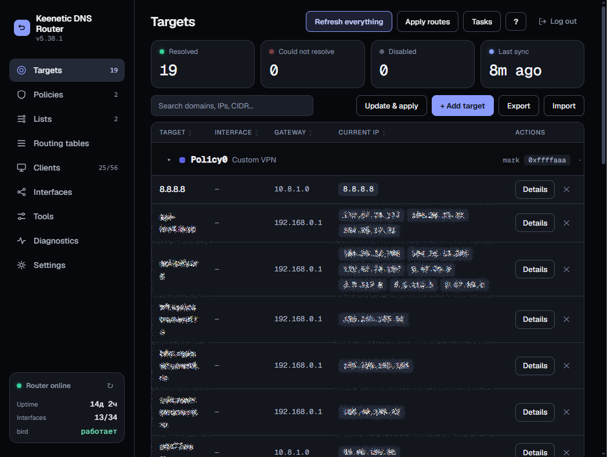
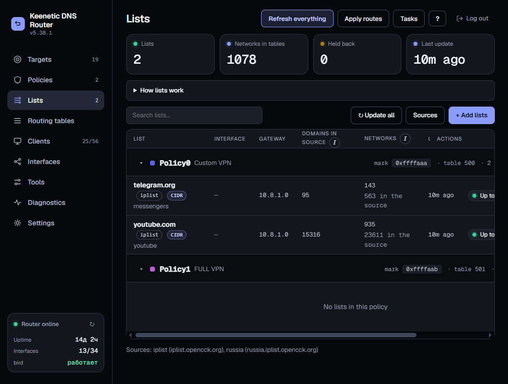
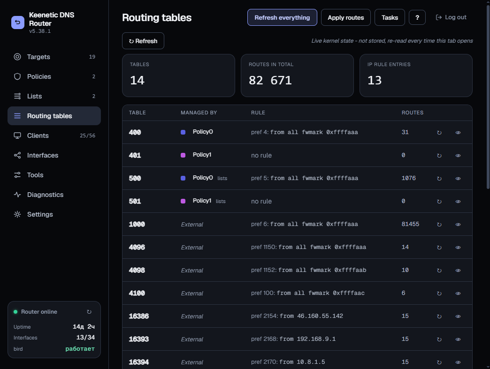
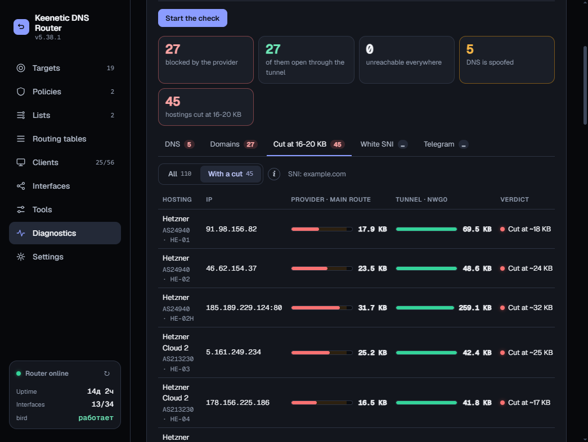

# Keenetic DNS Router

Панель для роутера Keenetic, которая направляет выбранные домены, IP-списки и целые сервисы
через нужную политику: VPN-туннель, второго провайдера или BGP-фид.

Цели хранятся в SQLite, разрешаются через выбранные вами DNS-серверы, IP-списки скачиваются
с источника вроде [iplist.opencck.org](https://iplist.opencck.org), а маршруты записываются в
таблицы политик роутера через `ip rule` / `ip route`. Всё работает на самом роутере под
Entware: PHP + nginx, без облака и без сборки.

**Версия 5.47.0** · [English](README.md) · [Изменения](CHANGELOG.ru.md) · [Changelog in English](CHANGELOG.md)

---

## Что делает

| Вкладка | Зачем |
|---|---|
| **Цели** | Домены, IP и сети, у каждой своя политика и выход (интерфейс и шлюз). Разрешаются по расписанию, сгруппированы по политикам, есть массовое редактирование и резервный выход. |
| **Политики** | Политики Keenetic с их fwmark и таблицей маршрутизации, живой трафик и число маршрутов. |
| **Списки** | Списки IP и доменов с источника, каталог сервисов и свои списки из вставленного текста или по ссылке. Подсети агрегируются, список, потерявший половину записей, придерживается. |
| **Клиенты** | Устройства с роутера, их политика, живые соединения, регистрация. |
| **Интерфейсы** | Интерфейсы роутера, адреса, статистика, пиры WireGuard, проверки доступности Keenetic (ping-check). |
| **Таблицы** | Живые таблицы и правила ядра, собственные статические маршруты роутера и порядок маршрутизации. |
| **Диагностика** | Проверка DPI по мотивам [dpi-detector](https://github.com/Runnin4ik/dpi-detector): подменённый DNS, сброс TLS по SNI, обрыв на 16–20 КБ, QUIC, белый SNI, дата-центры Telegram. |
| **Сервис** | Тест маршрута (настоящий `curl` через интерфейс маршрута), bird4/BGP с мастером конфига, ndm-хуки, проверки системы. |
| **Настройки** | DNS для резолва доменов, скачивание через интерфейс, пауза между задачами, таймауты и лимиты, обновление панели с GitHub. |

Маршруты применяются без разрыва: новые записываются поверх старых, и только потом убираются
устаревшие — трафик всё время имеет маршрут. Если ничего не изменилось, ничего не пишется и
root не вызывается.

Долгая работа (резолв, скачивание, применение) идёт фоновой задачей на роутере с очередью и
логом — страницу можно закрыть. ndm-хуки заново применяют маршруты, когда пересобран файрвол
или изменился интерфейс.

## Скриншоты





## Требования

* Keenetic с включённым компонентом **«Пакеты OPKG»** и Entware на накопителе.
* nginx + `php-fpm` и `php-cli`, **PHP 8.1 или новее** (используется `array_is_list()`), с `php-mod-sqlite3`.
* `ip-full` (busybox-ный `ip` не умеет `route get ... mark`), `curl`, `ca-bundle`.
* По желанию: `php-mod-openssl` и `php-mod-sockets` для колонок DoT и QUIC в проверке DPI,
  `bird1-ipv4` для BGP.
* Пароль admin веб-интерфейса Keenetic — он нужен для `su`, чтобы выполнять `ip rule` / `ip route`.

Панель проверяет всё это сама: **Сервис → Проверки системы** или `app.php checks` из шелла.
К каждому проваленному пункту приложена команда, которая его исправляет.

## Установка

### install.sh — обычный путь

Скачайте из релиза `install.sh` и `dns-router.tar.gz` в одну папку на роутере и запустите
от root:

```sh
sh install.sh
```

Если архива рядом нет, `install.sh` сам скачает последний релиз. Он спросит пароль admin
роутера и пароль для входа в панель (Enter — сгенерировать), предложит bird/BGP и порт панели
(по умолчанию **880**), поставит пакеты Entware, поправит `php.ini` и php-fpm, запишет
`nginx.conf`, распакует панель, затем вызовет `app.php install` и проверит, что панель отвечает.

| Переменная | Что значит | По умолчанию |
|---|---|---|
| `MANUAL=1` | Не трогать nginx, `php.ini`, php-fpm и пакеты — только файлы панели | выключено |
| `WWW=/путь` | Каталог панели | `/opt/share/www/dns-router` |
| `PORT=NNN` | Порт панели | `880` |
| `RCI=http://127.0.0.1:NN` | Адрес локального RCI Keenetic | `http://127.0.0.1:79` |
| `WITH_BIRD=1` | Поставить bird, не спрашивая | выключено |
| `RELEASE_URL=…` | Откуда скачивать архив | последний релиз GitHub |
| `WEBUSER_ENV=имя` | Пользователь php-fpm в режиме `MANUAL=1` | берётся от владельца конфига |

Уже установленная панель узнаётся по `config.php`: пароль роутера повторно не спрашивается,
файлы заменяются, недостающее починяется. **Панель 4.x обновляется на месте** — её каталог
находится по `api.php`, а `lib.php`, `api.php`, `css/`, `js/` и остальные старые скрипты потом
удаляются. Перед всем этим старая панель, конфиг и база упаковываются в
`/opt/var/dns-router-backup/before-install-<дата>/`, и путь печатается в конце — по нему можно
откатиться.

В конце печатаются адрес панели, логин, сгенерированный пароль (если он был) и вывод
`app.php checks`. Оставшиеся задания cron и чужие ndm-хуки старой панели только называются,
не удаляются.

### app.php install — вручную

Положите файлы панели в каталог, который отдаёт nginx (например `/opt/www/dns-router`),
затем от root:

```sh
DNSR_ROUTER_PASS='пароль-admin-keenetic' \
DNSR_PANEL_PASS='пароль-панели' \
DNSR_WEB_USER=nobody \
/opt/bin/php-cli /opt/www/dns-router/app.php install
```

| Переменная | Что значит | По умолчанию |
|---|---|---|
| `DNSR_ROUTER_PASS` | Пароль admin Keenetic, нужен для `su` | обязательна |
| `DNSR_PANEL_PASS` | Пароль самой панели (4 символа и больше) | обязательна |
| `DNSR_PANEL_USER` | Логин панели | `admin` |
| `DNSR_WEB_USER` | Пользователь, под которым работает nginx/php-fpm | `nobody` |
| `DNSR_CONF_DIR` | Где живут `config.php` и база | `/opt/etc/dns-router` |
| `DNSR_RCI` | Адрес локального RCI Keenetic | `http://127.0.0.1:79` |

`app.php install` пишет `config.php`, создаёт базу, ставит ndm-хуки и правит владельцев, чтобы
веб-пользователь мог писать. Существующие конфиг и база сохраняются. nginx, `php.ini` и пакеты
он не трогает вовсе — это работа `install.sh`.

Ещё можно открыть панель в браузере и пройти мастер из двух шагов: он покажет проверки
системы, спросит доступ к роутеру и логин панели, затем создаст базу.

`config.php` ищется в таком порядке: `$DNSR_CONFIG`, `/opt/etc/dns-router/config.php`,
`config.php` рядом с `app.php`. См. [config.example.php](config.example.php).

### nginx

`install.sh` пишет свой `nginx.conf` (старый сохраняется как `nginx.conf.orig`) и отказывается
продолжать, если nginx его не принял. С `MANUAL=1` он оставляет вашу настройку как есть и
вместо этого печатает строки, которые надо добавить. `app.php install` nginx не трогает вообще.

В любом случае убедитесь, что `config.php` (в нём пароль роутера), база и `ext.php` не отдаются
наружу: держите конфиг и базу вне веб-каталога (по умолчанию `/opt/etc/dns-router` уже снаружи)
или закройте их явно:

```nginx
location ~ ^/(config\.php|routes\.db|ext\.php|dpi/.*)$ { return 404; }
client_max_body_size 8m;   # загрузка обновления через вкладку «Настройки»
```

Если панель доступна извне локальной сети, отдавайте её по HTTPS. `app.php` сам отправляет
`X-Content-Type-Options: nosniff` и `X-Frame-Options: DENY`, а страница несёт
Content-Security-Policy, запрещающую чужие скрипты.

`client_max_body_size` — внешний потолок загружаемого обновления. Свой лимит панели лежит в
**Настройки → Таймауты и лимиты → Панель и безопасность → Наибольший архив обновления**
(по умолчанию 5 МБ). Поднять лимит панели выше 8 МБ имеет смысл только вместе с nginx.

## Командная строка

```
app.php <apply|update|event|sync|listsync|job|fetch|passwd|hooks|checks|install>
```

| Команда | Что делает |
|---|---|
| `apply` | Записать маршруты из того, что сохранено — без DNS-запросов и скачиваний. |
| `update` / `event` | Поставить задачу в очередь (это и вызывают ndm-хуки). |
| `sync` | Перечитать политики из Keenetic. |
| `fetch <url>` | Проверить путь загрузки с настройками самой панели: папка, curl, интерфейс, секунды, байты и причина отказа. |
| `checks` | Проверки системы с командами, которые их исправляют. |
| `hooks` | Переустановить ndm-хуки. |
| `passwd <новый>` | Сменить пароль панели. |
| `install` | Поставить или починить панель (см. выше). |

## Обновления

**Настройки → Обновление панели** показывает свежий релиз и что изменилось, скачивает
`dns-router.tar.gz` с GitHub, сверяет его с sha256, который публикует GitHub, проверяет
синтаксис PHP каждого файла и ставит с откатом. Версия старее или такая же отвергается.
Архив `.tar.gz` можно также загрузить вручную.

Из архива берутся только эти файлы: `app.php`, `ext.php`, `index.html`, `app.js`, `style.css`
и `lang.<код>.json`. Всё остальное — включая записи каталогов — заставляет панель отвергнуть
весь архив.

### Выпуск релиза

Пометьте коммит тегом `vX.Y.Z` и запушьте тег. Версия живёт в **четырёх** местах, и они обязаны
совпадать: `APP_VERSION` в `app.php`, `JS_VERSION` в `app.js`, строка `Версия X` под заголовком
этого файла и строка `Version X` в [README.md](README.md).

В `index.html` номера нет: бейдж в сайдбаре заполняет `app.js` из `JS_VERSION`, поэтому
страница, задержанная кэшем браузера, не может показать версию, которая не работает.
Воркфлоу [.github/workflows/release.yml](.github/workflows/release.yml) проверяет синтаксис
всех файлов, включая `install.sh`, собирает `dns-router.tar.gz` ровно из разрешённых файлов и
публикует релиз с описанием из `CHANGELOG.md` и `CHANGELOG.ru.md`.

В релизе два ассета: `dns-router.tar.gz` (то, что ставит панель) и `install.sh` (то, что вы
запускаете на роутере). `install.sh` нарочно **не** внутри архива — панель отвергает любой
файл, которого не знает.

Собрать тот же архив руками:

```sh
tar --no-recursion --format=gnu -czf dns-router.tar.gz \
    app.php ext.php index.html app.js style.css lang.ru.json
```

`--no-recursion` с явным списком файлов важен: достаточно одной записи каталога внутри
архива, чтобы панель его отвергла.

### Копирование релиза поверх локального клона

Перед коммитом проверьте, что git показал все изменённые файлы. Раньше у всех файлов архива
стояла одна и та же метка времени, а git считает файл неизменным, если совпали и размер, и
метка из индекса: правка, заменившая только цифры версии, могла остаться невидимой. Теперь
метки времени в архиве зависят от содержимого файла, и в этой сборке каждый файл ещё и
отличается размером. Если какого-то файла всё ещё нет в списке, выполните в репозитории
`git update-index --really-refresh`.

Переводы строк заданы в [.gitattributes](.gitattributes): каждый текстовый файл хранится и
выгружается с LF, что бы ни говорил `core.autocrlf` в Windows. Именно это убирает
предупреждение GitHub Desktop «This file uses LF line endings, but Git is configured to
convert them to CRLF the next time the file is checked out». Это не косметика: `install.sh`
с CRLF на роутере не запускается (`sh -n` даёт синтаксическую ошибку), а воркфлоу отказывается
собирать релиз, если в текстовом файле появился CR. Если в старом клоне уже есть CRLF, один
раз выполните `git add --renormalize .` и закоммитьте.

## Таймауты и лимиты

**Настройки → Таймауты и лимиты** держит все таймауты и все лимиты панели: **57 величин в
восьми группах** («Загрузки», «Разрешение DNS», «Списки», «Задачи и роутер», «Хуки»,
«Проверка DPI», «Диагностика и таблицы», «Панель и безопасность»). У каждого поля видны
единицы, допустимые границы и подсказка, что оно меняет. Стрелка рядом с полем, кнопка под
группой и **«Сбросить всё»** возвращают значения по умолчанию.

* Реестр — `PANEL_LIMITS` в `app.php`: одна строка на величину, с умолчанием, границами,
  единицами, группой, подписью и подсказкой. Код читает значение через `limit('ключ')` —
  самих таймаутов и лимитов в коде больше нет.
* Умолчания — ровно то, как панель работала до появления настроек, поэтому обновление не
  меняет поведение, пока вы не тронете поле.
* Значение, равное умолчанию, **не хранится**. В базе лежит только то, что вы действительно
  изменили (`lim_<ключ>` в `settings`), поэтому следующая версия сможет улучшить умолчание,
  которое вы не трогали, а ваши правки останутся.
* Значения проверяются при сохранении (границы, целое там, где нужно целое, и две пары,
  осмысленные только по порядку) и зажимаются в границы при чтении, поэтому вручную
  исправленная база не может сломать панель.
* Все значения читаются одним запросом за запрос страницы: `limit()` стоит в горячих местах.
  Уже идущая задача работает с теми значениями, с которыми началась — правка применится к
  следующей.
* Пауза между задачами (`job_delay`) и раньше была настройкой карточки «Панель» — там и
  осталась.

Два числа оставлены фиксированными намеренно: таблица списков = таблица политики + 100, поэтому
число политик ограничено сотней самой этой разметкой; и тест DPI всегда отправляет одно и то же
число набитых запросов — на этом держится измерение.

## Языки

Английский встроен: все строки в коде английские. Язык — это файл `lang.<код>.json` рядом с
`app.php`:

```json
{ "_name": "Русский", "strings": { "English text": "Перевод" } }
```

В ключах можно использовать `{0}`, `{1}`… для значений. DOM переводится по мере появления,
поэтому остальной код пишет обычный английский. Русский едет вместе с панелью.

## Замечания

* Все временные файлы — состояние и логи задач, замки, загрузки, каталоги обновления — лежат
  в одной папке: `/opt/tmp`, если она доступна, иначе системная. Какая именно используется,
  показывает **Сервис → Проверки системы**.
* Собственный трафик роутера не ходит по политикам Keenetic. Поэтому проверка DPI, curl теста
  маршрута и загрузки панели выбирают интерфейс явно.
* Вход — подписанная кука, без PHP-сессий (`ext-session` в Entware часто отсутствует); смена
  пароля панели гасит все куки. Пять неверных паролей с одного адреса блокируют вход на пять
  минут — оба числа лежат в **Настройки → Таймауты и лимиты → Панель и безопасность**.

## Документация

* [README.md](README.md) — те же инструкции по-английски.
* [CHANGELOG.ru.md](CHANGELOG.ru.md) / [CHANGELOG.md](CHANGELOG.md) — что менялось; они же
  служат описанием релиза на GitHub.
* [NOTICE.md](NOTICE.md) — сторонние материалы.
* [LICENSE](LICENSE) — лицензия MIT этого проекта.

## Сторонние материалы

См. [NOTICE.md](NOTICE.md). Проверка DPI следует идее и встроенным спискам
[Runnin4ik/dpi-detector](https://github.com/Runnin4ik/dpi-detector) (MIT); сами проверки
написаны заново на PHP. Данные списков скачиваются с источника во время работы и в этот
репозиторий не входят.

## Лицензия

[MIT](LICENSE) · Copyright (c) 2026 korovkin37-stack.

Пользуйтесь, меняйте, распространяйте, в том числе продавайте — единственное условие:
сохранять уведомление об авторстве и текст разрешения в копиях. Панель поставляется без
каких-либо гарантий: она пишет маршруты в работающий роутер, поэтому перед первым запуском
сохраните резервную копию конфигурации.

Сторонние материалы остаются под своими лицензиями — см. [NOTICE.md](NOTICE.md).
